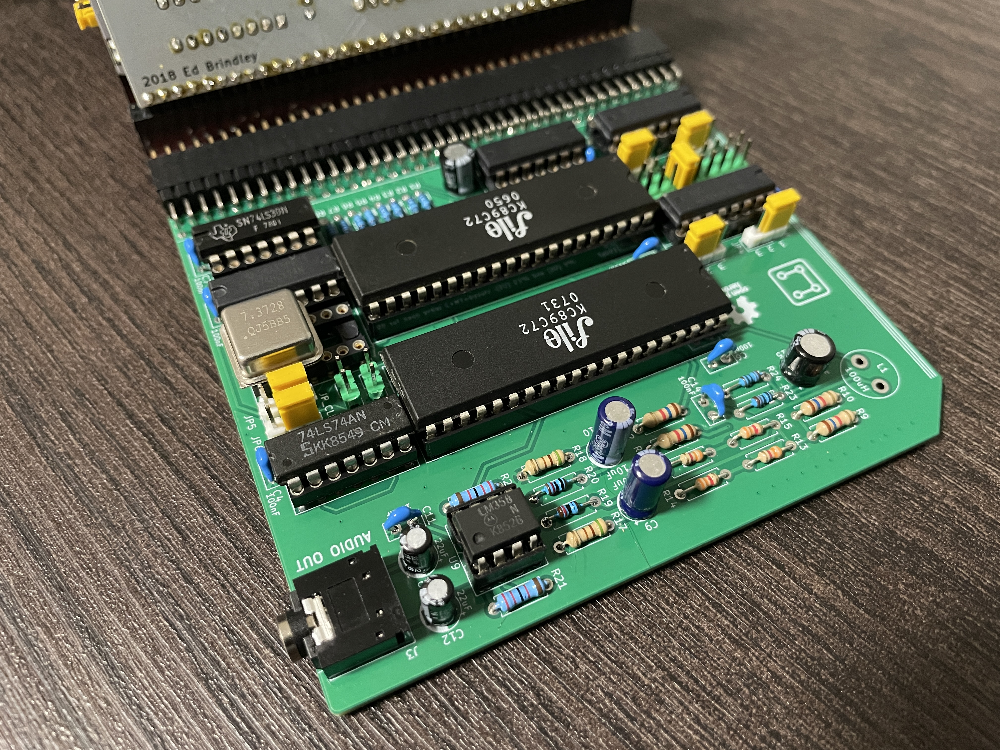

# RC2014 Turbo Sound

An original dual AY/YM TurboSound board for RC bus systems and compatible Z80 computers. The design combines two AY-compatible sound chips, a stereo audio output, selectable address decoding, and clock-source/divider options.

The schematic and PCB were developed for this project. The compact DIP layout was designed to fit within the RC bus width while keeping the board height acceptable.

## Features

- Two AY-3-8910 or YM2149-compatible sound chips.
- TurboSound chip selection through the board's `$F8` / `$F9` soft-select commands.
- Selectable MSX-style 8-bit I/O and ZX Spectrum-style 16-bit I/O address decoding.
- Onboard oscillator or RC bus clock, with selectable clock division.
- Stereo audio output.
- Two-row J1 RC bus connector footprint; one row provides the electrical connection and the additional row supports RC bus fit and mechanical stability.

---

*Video demonstration of the project.*

---

## Compatibility

Designed for RC bus / RC2014 systems, including compatible SC7xx RCBus computers. It can also be used with a ZX Spectrum through an appropriate adapter and matching software configuration.

TSPLAYER is the companion CP/M/RomWBW PT3 player: [r0b0t1cu/TSPLAYER](https://github.com/r0b0t1cu/TSPLAYER). TSPLAYER controls the two AY chips through the board's shared AY port pair and `$F8` / `$F9` selection commands. Its eight-LED level display uses the separate RCBus Digital I/O module at port 0.

## Design and documentation files

| File | Description |
| --- | --- |
| [`RC2014-Turbo-Sound-KiCad/`](RC2014-Turbo-Sound-KiCad/) | Editable KiCad schematic, PCB, project, and custom RC bus footprints |
| [`docs/schematic.pdf`](docs/schematic.pdf) | Schematic PDF |
| [`docs/images/turbosound-board-photo.jpg`](docs/images/turbosound-board-photo.jpg) | Photograph of the assembled board |
| [`docs/images/board-top.png`](docs/images/board-top.png) | Top-side PCB render |
| [`docs/images/board-bottom.png`](docs/images/board-bottom.png) | Bottom-side PCB render and silkscreen jumper legend |
| [`docs/ibom.html`](docs/ibom.html) | Interactive bill of materials |
| [`docs/JUMPER_SETTINGS.md`](docs/JUMPER_SETTINGS.md) | Address, mode, clock, and connector notes |

## Fabrication files

Generated files are in [`production/2026-11-07-21-17-36/`](production/2026-11-07-21-17-36/): [BOM](production/2026-11-07-21-17-36/RC2014-Turbo-Sound.kicad_pcb_bom.csv), [component positions](production/2026-11-07-21-17-36/RC2014-Turbo-Sound.kicad_pcb_positions.csv), [IPC netlist](production/2026-11-07-21-17-36/RC2014-Turbo-Sound.kicad_pcb_netlist.ipc), and [Gerber archive](production/2026-11-07-21-17-36/RC2014-Turbo-Sound.kicad_pcb_gerber.zip).

If you enjoy my projects and would like to support my work, you can do so through PCBWay. You can also order the PCBs for this project directly from the link below. Every bit of support is appreciated!

  

## Design inspiration and credits

The design was inspired by the TurboSound interface concepts in [KTS](https://github.com/konkotgit/KTS) and the AY/YM sound-board work in [electrified/rc2014-ym2149](https://github.com/electrified/rc2014-ym2149). Those projects remain the work of their respective authors. The schematic implementation and PCB layout in this repository were developed for this board.

## License

Hardware design files are released under the **CERN Open Hardware Licence Version 2 – Permissive (CERN-OHL-P-2.0)**. See [LICENSE](LICENSE). The license permits use, modification, manufacture, and sale, subject to its terms and notices.

Copyright © 2025-2026 r0b0t1cu.
